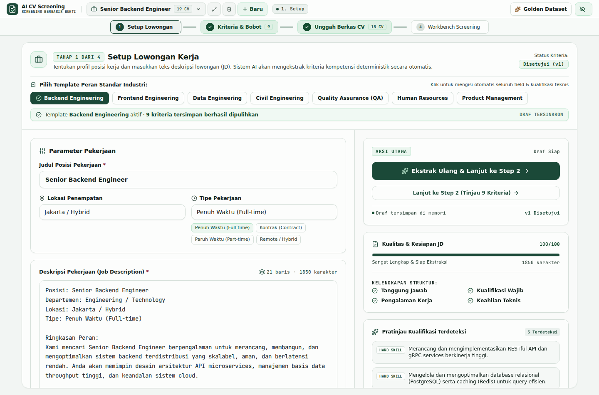
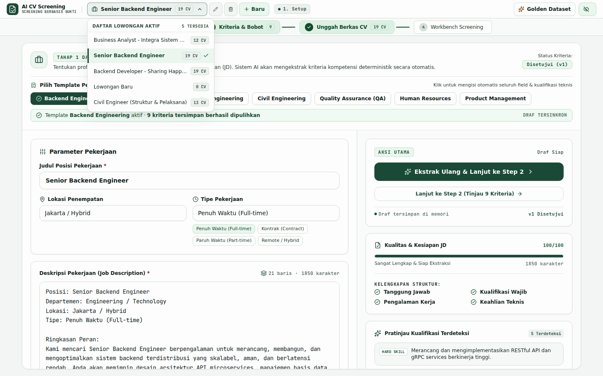
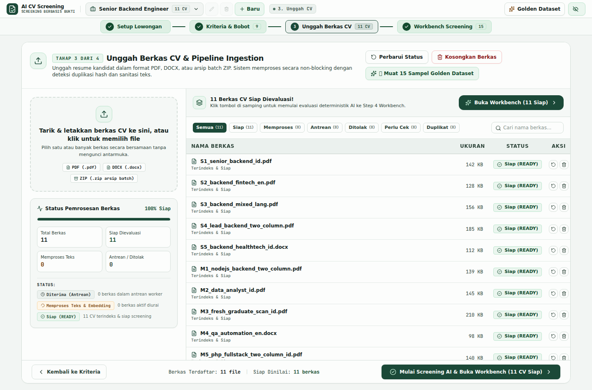
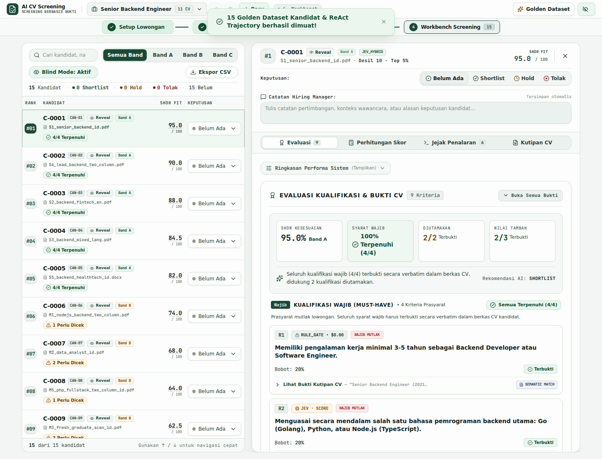
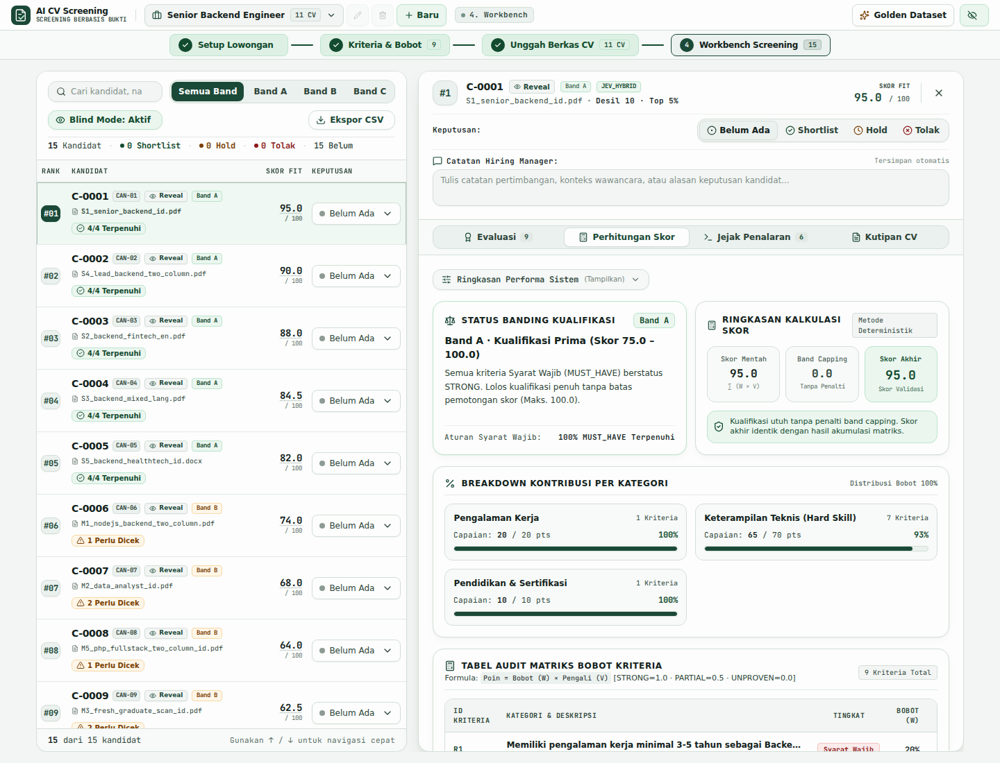
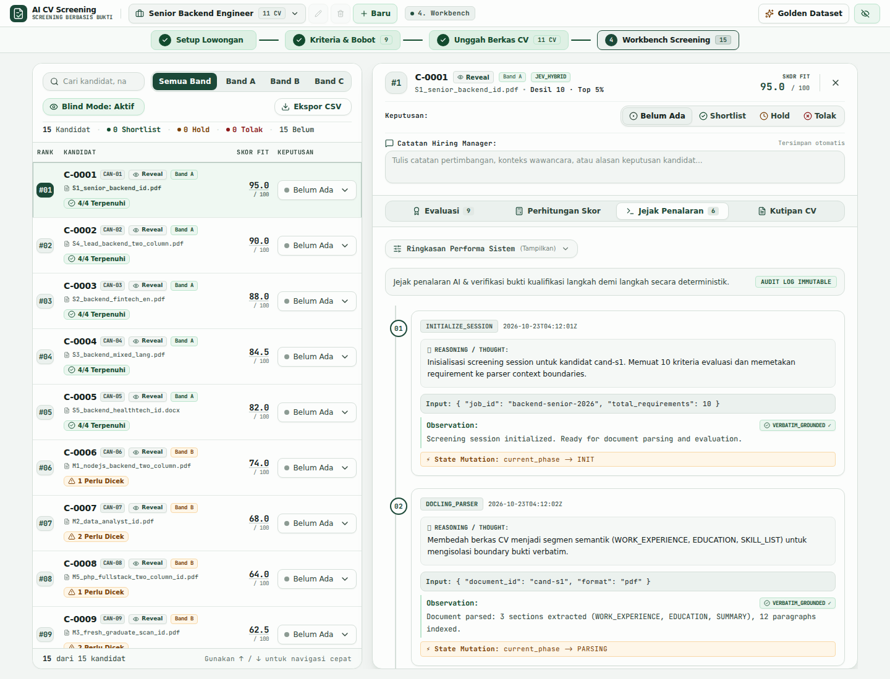
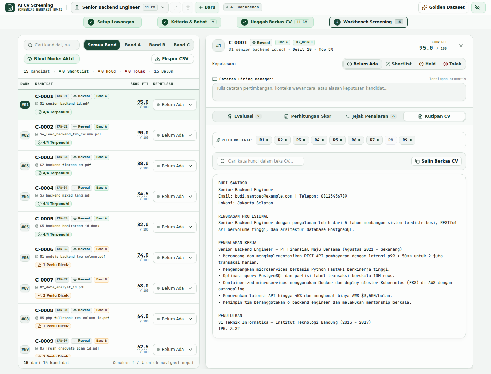

# BUKU PANDUAN PENGGUNA (USER MANUAL)
## PLATFORM SELEKSI & PEMERINGKATAN CV BERBASIS BUKTI

---

### Informasi Dokumen
* **Nama Sistem**: AI CV Screening & Candidate Ranking Platform
* **Akses Aplikasi**: `https://screening.alifihsan.my.id`
* **Arsitektur Inti**: Dual-Engine AI (9Router Local Gateway + TypeSafe Jev System One)

---

## DAFTAR ISI
1. [Pendahuluan & Konsep Utama](#1-pendahuluan--konsep-utama)
2. [Akses Sistem](#2-akses-sistem)
3. [Alur Operasional 4 Langkah Utama](#3-alur-operasional-4-langkah-utama)
   - [Langkah 1: Setup Lowongan Kerja & Template](#langkah-1-setup-lowongan-kerja--template)
   - [Langkah 2: Studio Kriteria & Pengaturan Bobot](#langkah-2-studio-kriteria--pengaturan-bobot)
   - [Langkah 3: Unggah Berkas Lamaran (CV)](#langkah-3-unggah-berkas-lamaran-cv)
   - [Langkah 4: Workbench Seleksi & Evaluasi Pelamar](#langkah-4-workbench-seleksi--evaluasi-pelamar)
4. [Panduan Lengkap Inspeksi Forensik Pelamar (4 Tab)](#4-panduan-lengkap-inspeksi-forensik-pelamar-4-tab)
   - [Tab 1: Evaluasi Kualifikasi & Bukti Kutipan](#tab-1-evaluasi-kualifikasi--bukti-kutipan)
   - [Tab 2: Transparansi Perhitungan Skor & Band Capping](#tab-2-transparansi-perhitungan-skor--band-capping)
   - [Tab 3: Jejak Penalaran AI (ReAct Logic Trace)](#tab-3-jejak-penalaran-ai-react-logic-trace)
   - [Tab 4: Grounding Naskah CV Asli (Text Highlight)](#tab-4-grounding-naskah-cv-asli-text-highlight)
5. [Fitur Pengambilan Keputusan & Ekspor Data](#5-fitur-pengambilan-keputusan--ekspor-data)
   - [Mode Penilaian Buta (Blind Review)](#mode-penilaian-buta-blind-review)
   - [Pemberian Keputusan & Catatan Hiring Manager](#pemberian-keputusan--catatan-hiring-manager)
   - [Ekspor Rekapitulasi ke Excel / CSV](#ekspor-rekapitulasi-ke-excel--csv)
6. [Tanya Jawab & Pemecahan Masalah (FAQ)](#6-tanya-jawab--pemecahan-masalah-faq)

---

## 1. PENDAHULUAN & KONSEP UTAMA

### Karakteristik Sistem
Platform AI CV Screening memisahkan secara tegas antara persepsi pembacaan dokumen dan agregasi skor matematis melalui **3 Prinsip Baku Kepatuhan**:
1. **Pencocokan Bukti Hibrida (Verbatim & Semantik)**: Kualifikasi pelamar diverifikasi melalui kombinasi pencocokan kata-demi-kata (*exact verbatim substring*) dan pencarian semantik (*dense vector embedding + Full-Text Search*) untuk mendeteksi variasi istilah atau sinonim kompetensi yang relevan pada dokumen pelamar.
2. **Perhitungan Matematis Murni**: Skor kecocokan pelamar dihitung menggunakan rumus aritmatika Multi-Criteria Decision Analysis ($\sum \text{Bobot} \times \text{Nilai Pemenuhan}$). AI tidak berhak menentukan angka skor secara langsung.
3. **Hard Band Capping (Hukuman Syarat Wajib)**: Jika pelamar tidak memenuhi syarat wajib (*MUST_HAVE*), nilai akhir kandidat dipotong secara otomatis ke batas maksimal tertentu (maksimal 74.0 untuk Band B, dan maksimal 49.0 untuk Band C). Ini menjamin pelamar tanpa syarat wajib tidak akan pernah lolos di peringkat atas.

---

## 2. AKSES SISTEM

Buka peramban (Google Chrome, Firefox, Safari, atau Microsoft Edge), lalu kunjungi alamat web resmi:
👉 **`https://screening.alifihsan.my.id`**

---

## 3. ALUR OPERASIONAL 4 LANGKAH UTAMA

Sistem ini dirancang dengan alur kerja bertahap (*funnel 4 langkah*) yang intuitif:

### Langkah 1: Setup Lowongan Kerja & Template

1. **Judul Posisi**: Ketikkan nama posisi yang sedang dibuka (contoh: *Senior Civil Engineer*, *Backend Developer*).
2. **Deskripsi Pekerjaan**: Tempelkan (*paste*) naskah kualifikasi dan tanggung jawab pekerjaan ke dalam kotak teks.
3. **Template Industri Siap Pakai**:
   - Di bagian atas kotak teks tersedia tombol template instan (misal: **Civil Engineer**, **Backend Go**, **Data Analyst**).
   - **Fitur Cerdas (Smart Switch)**: Jika Anda mengklik template yang sebelumnya sudah pernah dibuat dan sudah memiliki data pelamar, sistem akan otomatis membuka lowongan yang sudah ada tersebut tanpa menghapus atau menimpa data yang telah diproses.
4. Klik tombol **Lanjut: Review Kriteria** untuk menuju langkah berikutnya.

---

### Langkah 2: Studio Kriteria & Pengaturan Bobot

Pada tahap ini, sistem secara otomatis mengekstrak syarat-syarat dari naskah lowongan menjadi kartu kriteria terstruktur dengan klasifikasi 3 tingkat kepentingan:

1. **Wajib (MUST_HAVE)**: Syarat mutlak yang tidak boleh ditawar (contoh: Pendidikan S1 Teknik Sipil, Minimal Pengalaman 3 Tahun). Kegagalan pada syarat ini akan mengaktifkan *Band Capping Penalty*.
2. **Diutamakan (PREFERRED)**: Kompetensi inti yang sangat diharapkan (contoh: Pengalaman manajemen proyek gedung bertingkat, sertifikasi K3 Konstruksi).
3. **Nilai Tambah (NICE_TO_HAVE)**: Kemampuan pendukung yang memberikan poin ekstra (contoh: Penguasaan software Primavera, kemampuan bahasa Inggris aktif).

**Tindakan Pengguna:**
- Anda dapat mengubah tingkat kepentingan (*tier*), menggeser bobot kualifikasi (1 hingga 5 bintang), atau menambahkan kriteria kustom.
- Setelah kriteria sesuai, klik tombol **Kunci & Lanjutkan**. Kriteria akan terkunci bersama kamus taksonomi industri terkait guna menjaga objektivitas audit.

---

### Langkah 3: Unggah Berkas Lamaran (CV)

1. **Format Berkas yang Didukung**: Berkas dokumen lamaran dalam format **PDF** maupun **DOCX** (Microsoft Word).
2. **Cara Unggah**: Tarik dan lepaskan (*drag and drop*) kumpulan berkas CV pelamar ke dalam area unggah, atau klik tombol **Pilih Berkas**.
3. **Pemindaian Keamanan Otomatis**:
   - Sistem secara otomatis memindai dan menggagalkan kecurangan berkas (seperti teks tersembunyi berukuran 0-point, font warna putih di atas kertas putih, dan karakter tak terlihat).
   - Data kontak pribadi (Nomor Telepon, Alamat Email) dienkripsi secara aman.
4. Klik tombol **Mulai Pemrosesan Seleksi** untuk menjalankan evaluasi berbasis bukti.

---

### Langkah 4: Workbench Seleksi & Evaluasi Pelamar

Halaman ini adalah pusat kendali (*dossier dashboard*) tempat seluruh kandidat yang telah dievaluasi ditampilkan dalam tabel pemeringkatan terurut dari nilai tertinggi ke terendah:

1. **Kolom Peringkat & Skor**: Menampilkan posisi peringkat, skor akhir (skala 0 - 100), dan kategori rekomendasi:
   - 🟢 **Band A (Sangat Direkomendasikan)**: Skor $\ge 75$ dan **seluruh syarat wajib terpenuhi**.
   - 🟡 **Band B (Dipertimbangkan)**: Memiliki nilai kompetensi baik, namun terdapat 1 syarat wajib yang belum terbukti kuat. Skor dibatasi maksimal 74.0.
   - 🔴 **Band C (Tidak Disarankan)**: Terdapat 2 atau lebih syarat wajib yang tidak terpenuhi. Skor dibatasi maksimal 49.0.
   - ⚪ **Band R (Butuh Peninjauan Manual)**: Bukti dokumen berada dalam status meragukan dan membutuhkan verifikasi langsung oleh HR.
2. **Filter & Pencarian**: Filter cepat pelamar berdasarkan Band rekomendasi atau cari nama kandidat tertentu.
3. **Tombol Aksi**: Klik tombol **Inspeksi Bukti** pada baris kandidat untuk melihat pembuktian detail.

---

## 4. PANDUAN LENGKAP INSPEKSI FORENSIK PELAMAR (4 TAB)

Ketika Anda mengklik tombol **Inspeksi Bukti**, panel audit mendalam akan terbuka di sisi kanan. Panel ini memiliki **4 Tab Interaktif**:

### Tab 1: Evaluasi Kualifikasi & Bukti Kutipan

Tab ini membedah kecocokan pelamar pada setiap butir kriteria lowongan:
- **Badge Status Bukti**:
  - `STRONG` (Terbukti Penuh): Ditemukan kalimat bukti eksak yang secara eksplisit menyatakan kualifikasi tersebut.
  - `PARTIAL` (Terpenuhi Sebagian): Kualifikasi terpenuhi namun terdapat rincian yang belum lengkap.
  - `UNPROVEN` (Tidak Terbukti): Tidak ditemukan bukti sah pada dokumen pelamar.
- **Kutipan Bukti Verbatim**: Setiap kriteria yang berstatus `STRONG` menyertakan teks kutipan asli dari CV pelamar.

---

### Tab 2: Transparansi Perhitungan Skor & Band Capping

Tab ini memberikan transparansi penuh mengenai asal-usul angka skor kandidat tanpa ada rumus rahasia:
- **Panel Ringkasan Skor**: Membandingkan **Skor Mentah** (*Raw Score*), **Status Pemotongan** (*Band Capping Penalty*), dan **Skor Akhir**.
- **Capaian per Kategori**: Diagram visual yang memperlihatkan persentase nilai pada kategori Pengalaman Kerja, Keterampilan Teknis, Pendidikan, dan Sertifikasi.
- **Tabel Rincian Kontribusi Kriteria**: Rincian matematis per kriteria mencakup nilai bobot kriteria ($W$), nilai pemenuhan ($V$: *Strong=1.0, Partial=0.5, Unproven=0.0*), dan total poin kontribusi terhadap skor akhir.

---

### Tab 3: Jejak Penalaran AI (ReAct Logic Trace)

Tab ini ditujukan bagi auditor dan pimpinan yang ingin mengetahui alur logika mesin saat menganalisis dokumen:
- Menampilkan rekaman langkah demi langkah (*Thought $\rightarrow$ Action $\rightarrow$ Observation*).
- Menunjukkan alat apa yang dipanggil oleh sistem (ekstraksi riwayat kerja, pencarian semantik, atau pengecekan taksonomi peran).

---

### Tab 4: Grounding Naskah CV Asli (Text Highlight)

Tab ini menampilkan teks utuh berkas lamaran kandidat:
- **Sorotan Otomatis**: Jika Anda mengklik kutipan bukti pada kriteria di Tab 1, sistem akan otomatis melompat dan menyorot (*highlight*) kalimat yang bersangkutan pada naskah dokumen asli di Tab 4.
- Recruiter dapat membaca konteks kalimat sebelum dan sesudah kutipan tersebut dengan sangat mudah.

---

## 5. FITUR PENGAMBILAN KEPUTUSAN & EKSPOR DATA

### Mode Penilaian Buta (Blind Review)
Untuk menghilangkan bias subjektif (seperti bias gender, almamater tertentu, atau latar belakang personal), aktifkan saklar **Mode Buta** di bagian atas tabel pelamar.
- Seluruh nama kandidat akan disamarkan menjadi kode anonim (misalnya `Kandidat #C01`, `Kandidat #C02`).
- Penilai dapat fokus 100% pada substansi kompetensi dan bukti riil.

### Pemberian Keputusan & Catatan Hiring Manager
Di bagian paling atas panel inspeksi kandidat:
1. **Tombol Keputusan Cepat**: Pilih salah satu status keputusan:
   - **Shortlist** (Kandidat Lolos ke Tahap Wawancara)
   - **Hold** (Disimpan sebagai Cadangan)
   - **Tolak** (Kandidat Tidak Memenuhi Syarat)
2. **Kolom Catatan Hiring Manager**: Ketikkan pertimbangan subjektif Anda (contoh: *"Pengalaman site manager sangat kuat di proyek flyover, jadwalkan wawancara teknis hari Selasa"*).
3. Catatan ini tersimpan secara permanen di peramban Anda dan cuplikan singkatnya akan langsung muncul pada tabel daftar pelamar.

### Ekspor Rekapitulasi ke Excel / CSV
Setelah proses penyaringan selesai:
1. Klik tombol **Ekspor CSV** yang terletak di pojok kanan atas tabel daftar pelamar.
2. Berkas CSV akan terunduh secara instan dengan format penomoran **UTF-8 BOM**.
3. Berkas ini dapat langsung dibuka dengan rapi di **Microsoft Excel**, **Google Sheets**, atau sistem HRIS internal tanpa ada teks yang rusak atau kolom yang bergeser.

---

## 6. TANYA JAWAB & PEMECAHAN MASALAH (FAQ)

**Q1: Mengapa kandidat dengan pengalaman kerja 10 tahun mendapat skor di bawah 75?**  
*Jawaban*: Periksa Tab Perhitungan Skor. Kemungkinan besar kandidat tersebut tidak memenuhi salah satu syarat wajib (*MUST_HAVE*, misalnya tidak memiliki sertifikasi keahlian tertentu yang disyaratkan mutlak di lowongan). Akibatnya, sistem memberlakukan *Hard Band Capping* (maksimal 74.0 untuk Band B) agar kandidat yang melanggar syarat wajib tidak menempati peringkat teratas.

**Q2: Bagaimana jika berkas PDF pelamar tidak terbaca atau rusak?**  
*Jawaban*: Sistem dilengkapi detektor berkas anti-kerusakan. Jika berkas diproteksi kata sandi (*password*) atau formatnya korup, sistem akan menandai berkas tersebut dengan status `INVALID_FILE` pada daftar unggah agar recruiter dapat meminta kandidat mengunggah ulang dokumen yang valid.

**Q3: Apakah catatan Hiring Manager saya akan hilang jika saya menutup peramban?**  
*Jawaban*: Tidak. Seluruh status keputusan (`Shortlist/Hold/Tolak`) dan Catatan Hiring Manager disimpan secara lokal dan persisten di penyimpanan browser (*localStorage*) per ID lowongan. Data tersebut tetap ada saat Anda membuka kembali halaman web.
