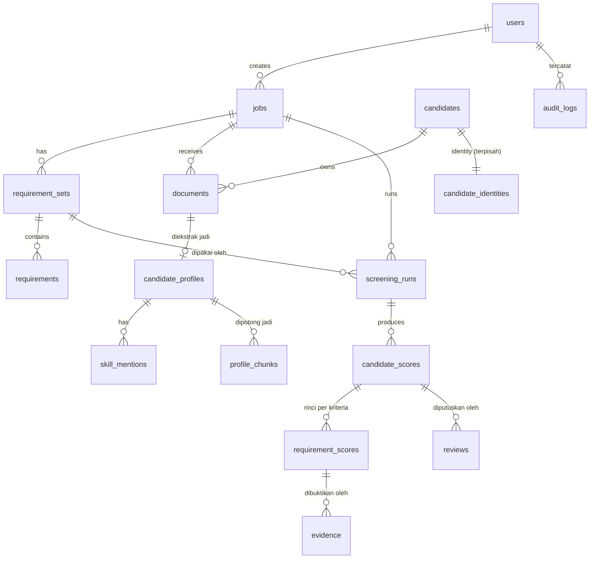

# 04 — Data Model & API Contract

DDL lengkap: `schemas/db_schema.sql`. JSON schema: `schemas/*.schema.json`. Kalau dokumen ini dan file
schema berbeda, **file schema yang berlaku**, dan agent mencatat perbedaannya di `ANSWERS.md`.

## 1. ERD



## 2. Tabel inti (ringkas)

Usulan awal punya 3 tabel (`jobs`, `candidates`, `screenings`). Itu tidak cukup untuk bukti per kriteria,
pemisahan identitas, dan hasil yang bisa diulang, jadi dipecah seperti di bawah.

| Tabel | Kolom penting | Catatan |
| --- | --- | --- |
| `users` | id, email, password_hash, role (`admin`/`recruiter`/`hiring_manager`), is_active | |
| `jobs` | id, tenant_id, title, location, employment_type, jd_text, status, created_by | |
| `requirement_sets` | id, job_id, version, status (`DRAFT`/`APPROVED`), category_weights, compiled_by_model_call_id, approved_by, approved_at | Immutable setelah `APPROVED` |
| `requirements` | id, requirement_set_id, requirement_id (`R1`…), description, category, kind, importance, weight, concepts, params, source_text, lint_flags | |
| `candidates` | id, tenant_id, candidate_code (`C-0001`), status, created_at, deleted_at | **Tanpa nama/email** |
| `candidate_identities` | candidate_id, full_name, email, phone, location_raw, other_personal (JSONB terenkripsi) | Hanya dibaca saat "tampilkan identitas"; tercatat audit |
| `documents` | id, job_id, candidate_id, original_filename, mime, size_bytes, pages, sha256, storage_key, status, reasons[], flags[], duplicate_of | Status: `RECEIVED`, `PROCESSING`, `READY`, `NEEDS_REVIEW`, `REJECTED`, `DUPLICATE` |
| `candidate_profiles` | id, document_id, profile (JSONB, `CandidateProfile`), matching_profile (JSONB, teredaksi), extractor_version, quality (JSONB) | |
| `skill_mentions` | id, profile_id, concept_id, surface_text, context, entry_ref, source (JSONB) | |
| `profile_chunks` | id, profile_id, kind, text_redacted, embedding `vector(1024)`, embedding_model, fts `tsvector` | Index HNSW + GIN |
| `screening_runs` | id, job_id, requirement_set_id, as_of, status, versions (JSONB), params (JSONB), parent_run_id, started_at, finished_at | Event immutable |
| `candidate_scores` | run_id, candidate_id, document_id, rank, band, raw_score, final_score, capped, recommendation, category_scores, flags[] | |
| `requirement_scores` | run_id, candidate_id, requirement_id, state, confidence, method (`rule`/`verifier`), metrics (JSONB) | |
| `evidence` | id, run_id, candidate_id, requirement_id, quote, page, char_start, char_end, bbox, context, verified | |
| `reviews` | id, run_id, candidate_id, reviewer_id, decision (`SHORTLIST`/`HOLD`/`NOT_PROCEED`), reason, note, created_at | |
| `model_calls` | id, task, provider, model, prompt_version, input_hash, output_hash, tokens_in, tokens_out, cost_usd, latency_ms, status | Tanpa teks CV |
| `llm_cache` | key (hash), task, output (JSONB), created_at | Untuk tidak bayar token dua kali |
| `jobs_queue` | id, type, payload, status, attempts, run_after, locked_at, error | Antrian worker |
| `audit_logs` | id, actor_id, action, target_type, target_id, metadata (JSONB, tanpa PII), created_at | Append-only |

## 3. Konvensi API

- Base path `/api/v1`, JSON, auth via cookie httpOnly (JWT).
- Operasi lama mengembalikan `202 Accepted` + resource yang bisa di-poll.
- Error seragam:

```json
{"error": {"code": "REQUIREMENTS_NOT_APPROVED", "message": "Kriteria belum disetujui.", "details": {}}}
```

- Pagination: `?cursor=…&limit=50`.
- Semua ID berupa UUID, kecuali `candidate_code` dan `requirement_id` untuk tampilan.

## 4. Endpoint

| Method & path | Fungsi |
| --- | --- |
| `POST /auth/login`, `POST /auth/logout`, `GET /auth/me` | Login |
| `POST /jobs` | Buat lowongan (JD teks atau file) |
| `GET /jobs`, `GET /jobs/{job_id}` | Daftar dan detail lowongan |
| `POST /jobs/{job_id}/requirements/compile` | Buat draf kriteria dari JD (async) |
| `GET /jobs/{job_id}/requirements` | Ambil set kriteria terbaru (draf atau disetujui) |
| `PUT /requirement-sets/{set_id}` | Simpan editan draf |
| `POST /requirement-sets/{set_id}/approve` | Setujui (mengunci versi) |
| `POST /jobs/{job_id}/requirements/import` | Import set kriteria JSON (admin; dipakai untuk golden dataset, langsung `APPROVED` dengan `approved_by` = admin) |
| `POST /jobs/{job_id}/cvs` | Upload batch CV (multipart, banyak file atau satu ZIP) |
| `GET /jobs/{job_id}/cvs/status` | Progress ingestion per file |
| `POST /jobs/{job_id}/screenings` | Mulai screening run |
| `GET /screenings/{run_id}` | Status dan metadata run |
| `GET /screenings/{run_id}/rankings` | Tabel ranking |
| `GET /screenings/{run_id}/candidates/{candidate_id}` | Detail kartu skor + bukti |
| `GET /screenings/{run_id}/compare?ids=a,b,c` | Perbandingan per kriteria |
| `POST /screenings/{run_id}/candidates/{candidate_id}/review` | Keputusan recruiter |
| `POST /candidates/{candidate_id}/reveal-identity` | Tampilkan identitas (tercatat audit) |
| `GET /documents/{document_id}/file` | Unduh/preview file asli (URL sementara) |
| `GET /screenings/{run_id}/export?format=xlsx\|csv` | Export untuk recruiter |
| `GET /screenings/{run_id}/eval-export` | Export format evaluator golden dataset |
| `GET /jobs/{job_id}/extraction-export` | Export profil hasil ekstraksi format evaluator |
| `DELETE /candidates/{candidate_id}` | Hapus permanen data kandidat |
| `POST /candidates/{candidate_id}/object` | Kandidat keberatan atas penilaian otomatis → `MANUAL_ONLY` |
| `GET /audit-logs` | Audit log (admin) |

Endpoint usulan awal tetap ada dengan penyesuaian: `upload-cvs` → `POST /jobs/{id}/cvs`;
`GET /jobs/{id}/rankings` → `GET /screenings/{run_id}/rankings` (ranking melekat pada run, bukan lowongan,
supaya bisa diulang dan dibandingkan); `GET /screenings/{id}/detail` →
`GET /screenings/{run_id}/candidates/{candidate_id}`.

## 5. Contoh request/response

### 5.1 Buat lowongan

```http
POST /api/v1/jobs
{"title": "Backend Engineer", "location": "Jakarta", "employment_type": "FULL_TIME",
 "jd_text": "Minimal 3 tahun pengalaman sebagai Backend Engineer..."}
→ 201 {"id": "6f1c…", "status": "DRAFT", "requirements_status": "NOT_COMPILED"}
```

### 5.2 Draf kriteria

```http
POST /api/v1/jobs/6f1c…/requirements/compile
→ 202 {"requirement_set_id": "a91e…", "status": "COMPILING"}

GET /api/v1/jobs/6f1c…/requirements
→ 200 {
  "requirement_set_id": "a91e…", "version": 1, "status": "DRAFT",
  "category_weights": {"EXPERIENCE": 40, "HARD_SKILLS": 30, "EDUCATION_CERT": 15, "ACHIEVEMENT": 15},
  "requirements": [
    {"requirement_id": "R1", "description": "Minimal 3 tahun pengalaman sebagai Backend Engineer",
     "category": "EXPERIENCE", "kind": "EXPERIENCE_DURATION", "importance": "MUST_HAVE", "weight": 25,
     "concepts": ["role_family:backend"], "params": {"min_months": 36, "accepted_role_families": ["backend", "fullstack"]},
     "source_text": "Minimal 3 tahun pengalaman sebagai Backend Engineer / Backend Developer.", "lint_flags": []},
    {"requirement_id": "R11", "description": "Usia maksimal 28 tahun", "category": "OTHER", "kind": "OTHER",
     "importance": "MUST_HAVE", "weight": 0, "lint_flags": ["PROHIBITED_AGE"]}
  ],
  "warnings": ["R11 dilarang dan harus dihapus sebelum disetujui."]
}
```

### 5.3 Upload

```http
POST /api/v1/jobs/6f1c…/cvs   (multipart: files[]=…)
→ 202 {"batch_id": "b77d…", "accepted": 48, "rejected": [{"filename": "foto.heic", "reason": "UNSUPPORTED_FORMAT"}]}

GET /api/v1/jobs/6f1c…/cvs/status
→ 200 {"total": 48, "ready": 15, "processing": 30, "needs_review": 2, "rejected": 1, "duplicate": 0,
       "items": [{"document_id": "…", "filename": "cv_andi.pdf", "status": "READY", "reasons": [], "flags": []}]}
```

### 5.4 Screening dan ranking

```http
POST /api/v1/jobs/6f1c…/screenings
{"requirement_set_id": "a91e…", "options": {"use_verifier": true, "as_of": "2026-10-01"}}
→ 202 {"run_id": "r-2026-10-09-001", "status": "QUEUED"}

GET /api/v1/screenings/r-2026-10-09-001/rankings?band=A,B&limit=50
→ 200 {
  "run_id": "r-2026-10-09-001", "status": "DONE", "as_of": "2026-10-09",
  "counts": {"A": 5, "B": 4, "C": 36, "R": 2, "not_scored": 3},
  "items": [
    {"rank": 1, "candidate_id": "…", "candidate_code": "C-0007", "display_name": null,
     "band": "A", "final_score": 100.0, "raw_score": 100.0, "capped": false,
     "recommendation": "SHORTLIST", "color": "green",
     "must_have_summary": {"strong": 3, "total": 3},
     "category_scores": {"EXPERIENCE": 100, "HARD_SKILLS": 100, "EDUCATION_CERT": 100, "ACHIEVEMENT": 100},
     "flags": [], "review": null}
  ]
}
```

`options.as_of` (tanggal acuan "sekarang" untuk menghitung durasi) default hari ini; hanya admin yang boleh
mengisinya, dan wajib `2026-10-01` saat menjalankan golden dataset.

`display_name` bernilai `null` saat blind mode aktif.

### 5.5 Detail kandidat

```http
GET /api/v1/screenings/r-…/candidates/…
→ 200 {
  "candidate_code": "C-0012", "band": "B", "final_score": 74.0, "raw_score": 77.0, "capped": true,
  "cap_reason": "Kriteria wajib R3 (Python) belum terbukti kuat.",
  "recommendation": "REVIEW",
  "profile_summary": {"headline": "Backend Developer (Node.js)", "total_relevant_months": 57,
                      "latest_role": "Backend Developer", "education": "S1 Teknik Informatika"},
  "requirements": [
    {"requirement_id": "R3", "description": "Python", "importance": "MUST_HAVE", "weight": 10,
     "state": "PARTIAL", "confidence": 0.95, "method": "rule",
     "evidence": [{"quote": "Python (basic)", "page": 1, "context": "skills_list", "verified": true}],
     "explanation": "Hanya tercantum di daftar skill."}
  ],
  "strengths": ["5 tahun pengalaman backend (Feb 2022 – sekarang)", "PostgreSQL dipakai di pekerjaan"],
  "gaps": ["Python hanya di daftar skill", "Kubernetes/cloud tidak tercantum di CV"],
  "interview_questions": ["Seberapa jauh pengalaman Python Anda di pekerjaan?"],
  "flags": [],
  "document": {"document_id": "…", "pages": 1, "preview_url": "/api/v1/documents/…/file?token=…"}
}
```

### 5.6 Keputusan recruiter

```http
POST /api/v1/screenings/r-…/candidates/…/review
{"decision": "NOT_PROCEED", "reason": "SKILL_GAP", "note": "Belum ada pengalaman Python di production."}
→ 201 {"review_id": "…"}
```

`reason` wajib untuk `NOT_PROCEED`: `SKILL_GAP`, `EXPERIENCE_GAP`, `LOCATION`, `SALARY`, `OTHER`.

### 5.7 Ekspor evaluasi (wajib untuk QA)

`GET /screenings/{run_id}/eval-export` mengembalikan format yang dibaca `golden_dataset/evaluate.py`:

```json
{
  "job_id": "JD-01",
  "run_id": "r-…",
  "results": [
    {"file": "S1_senior_backend_id.pdf", "status": "SCORED", "rank": 1, "band": "A",
     "score": 100.0, "raw_score": 100.0, "recommendation": "SHORTLIST",
     "requirement_states": {"R1": "STRONG", "R2": "STRONG", "R3": "STRONG"},
     "metrics": {"backend_months": 88},
     "flags": [], "reasons": [], "duplicate_of": null}
  ]
}
```

- `file` = nama file asli. `status` ∈ `SCORED`, `NEEDS_REVIEW`, `REJECTED`, `DUPLICATE`.
- `requirement_states` memakai `requirement_id` dari requirement set (untuk golden dataset: R1–R10 dari file
  `JD-01_requirements.approved.json` yang di-import apa adanya).
- `metrics.backend_months` = bulan pengalaman setara untuk kriteria `EXPERIENCE_DURATION` (boleh dihilangkan).

`GET /jobs/{job_id}/extraction-export` mengembalikan:

```json
{"files": {"S1_senior_backend_id.pdf": {
  "experiences": [{"title": "Senior Backend Engineer", "organization": "PT Kilat Logistik Digital",
                   "start": "2022-03", "end": "present", "employment_type": "full_time"}],
  "education": [{"level": "S1"}],
  "certifications": ["AWS Certified Developer – Associate"],
  "skills": ["Python", "FastAPI"]}}}
```

## 6. Export untuk recruiter (XLSX/CSV)

Sheet `Ranking`: Peringkat, Kode Kandidat, Nama (kosong kalau blind mode), Band, Skor Akhir, Skor Dasar,
Rekomendasi Sistem, Keputusan Recruiter, Alasan Keputusan, satu kolom per kriteria (status), Kelebihan
utama, Belum terbukti, Flag.
Sheet `Bukti`: Kode Kandidat, Kriteria, Status, Kutipan, Halaman.
Sheet `Info Run`: lowongan, tanggal, versi kriteria, versi model, catatan "Rekomendasi sistem bukan keputusan
akhir".

## 7. Enum

| Enum | Nilai |
| --- | --- |
| `state` | `STRONG`, `PARTIAL`, `NOT_DEMONSTRATED`, `UNKNOWN` |
| `band` | `A`, `B`, `C`, `R` |
| `recommendation` | `SHORTLIST`, `REVIEW`, `LOW_PRIORITY`, `MANUAL_CHECK` |
| `document.status` | `RECEIVED`, `PROCESSING`, `READY`, `NEEDS_REVIEW`, `REJECTED`, `DUPLICATE` |
| `reasons` | `INSUFFICIENT_CONTENT`, `EMPTY_DOCUMENT`, `LOW_OCR_QUALITY`, `ENCRYPTED_FILE`, `UNSUPPORTED_OR_CORRUPT`, `NOT_A_CV`, `MALWARE` |
| `flags` | `HIDDEN_TEXT`, `PROMPT_INJECTION`, `KEYWORD_STUFFING`, `DATE_ANOMALY`, `POSSIBLE_DUPLICATE`, `LOW_CONFIDENCE`, `NO_EVIDENCE_FOUND`, `GROUNDING_FAIL`, `TRUNCATED`, `LANGUAGE_UNSUPPORTED` |
| `context` (bukti) | `experience`, `internship`, `freelance`, `project`, `organization`, `education`, `certification`, `skills_list`, `summary` |
